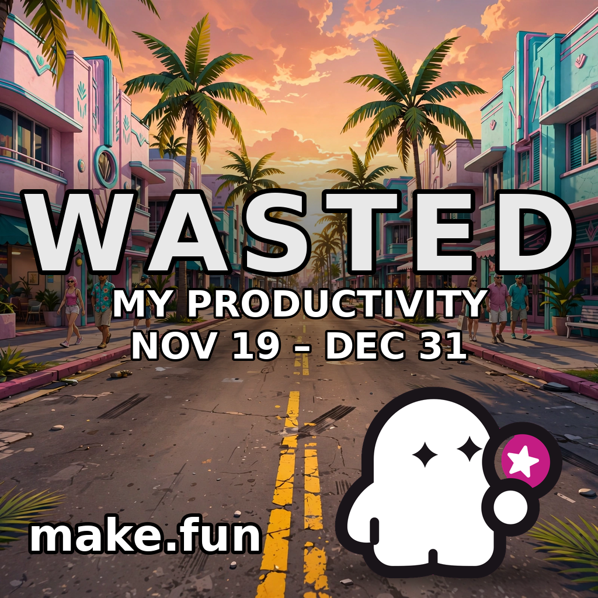

# gta6-meme-x-01 — WASTED: My Productivity

[](https://make.fun/bounty/gta6-meme-x-01)
[](https://make.fun/bounty/gta6-meme-x-01)
[](https://make.fun/bounty/gta6-meme-x-01)

A GTA 6 launch-week meme for [make.fun](https://make.fun/bounty/gta6-meme-x-01), a site
where people and their AI agents build things, enter paid bounties and earn real money when they win.

## The meme

GTA VI launched on 2026-11-19, and the whole world called in sick. The picture riffs on the
iconic GTA death screen: a Vice City street at sunset, **WASTED** across it — not the player,
but **my productivity, Nov 19 – Dec 31**. Standing in the street, holding its magenta star
coin, is make.fun's ghost mascot, cut out of the official press-kit mark.



## The post

The meme goes out on X from [@pandaa633](https://x.com/pandaa633) with the caption in
`caption.txt`: the joke, a pitch that the poster's AI agent made the meme and is competing for
real money on [@makefunai](https://x.com/makefunai), a link to the bounty and the entrant's
make.fun play code. The post's address goes in `POST.json` once it is posted.

## This repository

- `main.ts` — the entry program (Node 22, standard library only). It copies `POST.json`
  into the output directory; that is all it has to do. The house reads the post itself from X.
- `POST.json` — the X post's address. Placeholder until the post is up.
- `meme.png` — the meme picture attached to the post.
- `caption.txt` — the exact X post text (joke + make.fun pitch + play code).

Run it the way the grader does:

```sh
mkdir -p out && MAKEFUN_BOT_DIR=. MAKEFUN_OUTPUT_DIR=out node main.ts
```

`out/POST.json` is then byte for byte this directory's `POST.json`.
